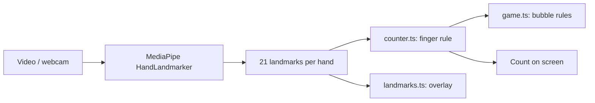

# finger-counter-web

Count the fingers you hold up, live in your browser, and pop number bubbles with your hands.

**Live demo: https://nuhregaibunsal.github.io/finger-counter-web/**

Browser port of my Python project [`finger-counter`](https://github.com/nuhregaibunsal/finger-counter).

## Features
- Hand tracking with MediaPipe Hands (`@mediapipe/tasks-vision` 0.10.21, loaded from a CDN)
- Works on an uploaded video, or on your webcam
- Landmark and skeleton overlay with a large live finger count (both hands, thumb handled by handedness)
- Bubble game: show the number on a bubble and hold it to pop it; score and lives
- Keyboard accessible, screen-reader announcements for the count, reduced-motion and light/dark support

## Privacy
Video and webcam frames never leave your device. All processing happens locally in the browser;
only the tracking library and model file are downloaded.

## Architecture


## Run
```bash
npm install
npm run dev
```

## Test
```bash
npm test
npm run build
```
